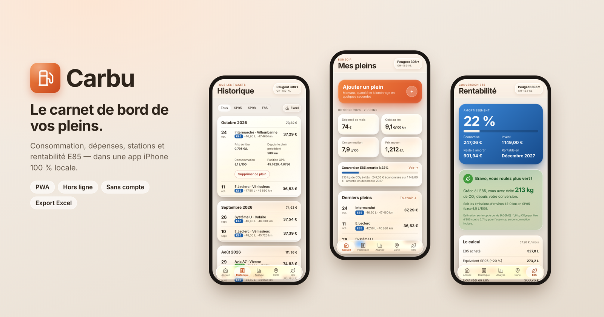
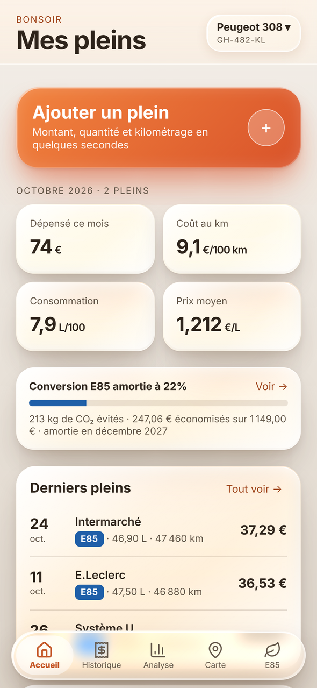
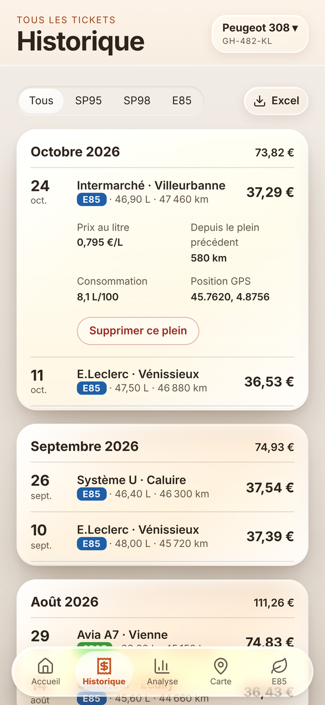
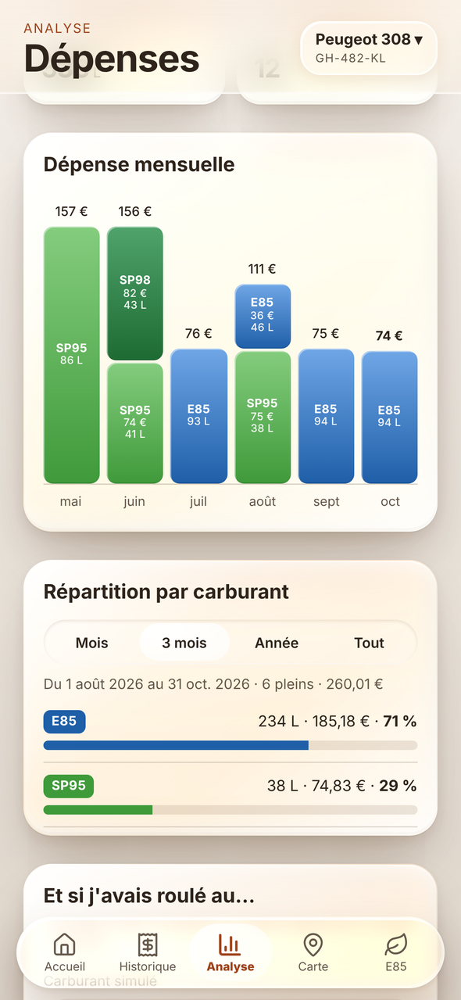
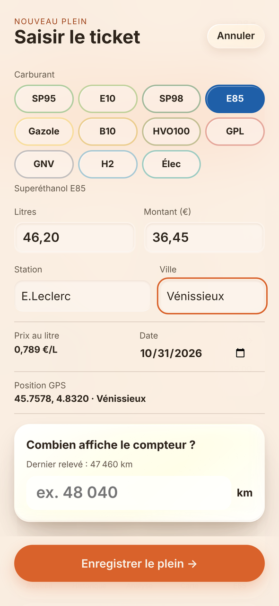
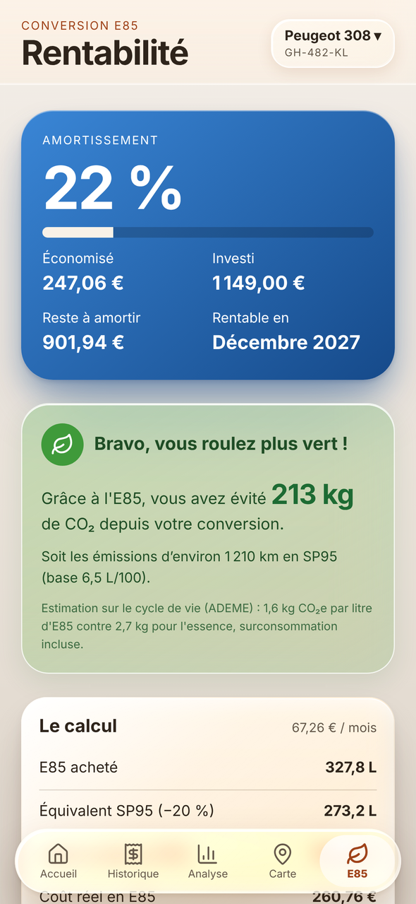
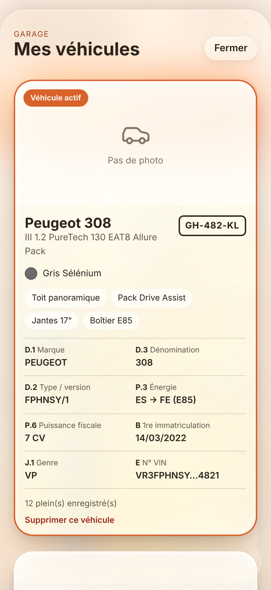

  

<h1 align="center">Carbu</h1>

  <b>Le carnet de bord de vos pleins de carburant, installable sur iPhone.</b> 
  Consommation, dépenses, stations et rentabilité E85. Sans compte, sans serveur, sans publicité.

  

  
  
  
  

---

## Aperçu

| Accueil | Historique | Analyse |
|:---:|:---:|:---:|
|  |  |  |
| **Saisie d'un plein** | **Rentabilité E85** | **Garage** |
|  |  |  |

Captures réalisées avec des données de démonstration.

## Fonctionnalités

- **Saisie rapide d'un plein** : carburant, quantité, montant, station, date et kilométrage. La position GPS est ajoutée automatiquement (si vous l'autorisez) et la ville est retrouvée toute seule.
- **Tableau de bord** : dépense du mois, coût aux 100 km, consommation réelle et prix moyen.
- **Historique** classé par mois, filtrable par carburant, avec le détail de chaque plein.
- **Analyse** : dépenses mensuelles par carburant, répartition, stations les moins chères, et simulateur « et si j'avais roulé au SP95 ? » avec les prix moyens nationaux du jour (prix-carburants.gouv.fr).
- **Carte** de vos stations (plan, satellite, mixte ou relief).
- **Rentabilité E85** : suivi de l'amortissement d'un boîtier ou d'une reprogrammation, économies réalisées et CO₂ évité.
- **Plusieurs véhicules**, avec photo et immatriculation.
- **Export Excel** de vos tickets sur la période de votre choix.
- **Sauvegarde et restauration** de toutes vos données dans un fichier.
- **11 énergies** gérées : SP95, E10, SP98, E85, Gazole, B10, HVO100, GPL, GNV, hydrogène et électricité.

## Installer sur iPhone

1. Ouvrez **[sudopush.github.io/carbu](https://sudopush.github.io/carbu/)** dans **Safari**.
2. Touchez le bouton **Partager**, puis **Sur l'écran d'accueil**, puis **Ajouter**.
3. Lancez Carbu depuis son icône : l'app s'ouvre en plein écran, comme une application native.

Sur Android, ouvrez le lien dans Chrome puis choisissez **Installer l'application**.

## Vos données restent chez vous

Carbu fonctionne entièrement sur votre téléphone. Tickets, véhicules et réglages sont enregistrés uniquement dans la mémoire de l'appareil : aucun compte, aucun serveur, aucun traceur.

Seules trois fonctions utilisent Internet, sans jamais envoyer vos pleins : le fond de carte (OpenStreetMap / Esri), les prix moyens nationaux (data.economie.gouv.fr) et le nom de la ville d'un plein, retrouvé à partir de sa position (OpenStreetMap Nominatim).

> [!TIP]
> Comme rien n'est stocké ailleurs, pensez à faire une sauvegarde de temps en temps : carte **« 100 % local »** sur l'accueil, puis **Sauvegarder mes données**. Le fichier se restaure en un geste sur un nouveau téléphone.

## Sous le capot

| Élément | Rôle |
|---|---|
| `index.html` | L'application (interface et logique) |
| `support.js` | Moteur de rendu des écrans |
| `react-bundle.js` | React, embarqué pour fonctionner hors ligne |
| `sw.js` | Service worker : ouverture instantanée et mode hors ligne |
| `manifest.webmanifest` | Nom, icône et affichage plein écran de l'app installée |
| `ds/styles.css` | Thème graphique |
| `icons/` | Icônes de l'application |

Aucune étape de compilation : le site est servi tel quel par GitHub Pages.

### Mettre à jour l'app

Remplacez les fichiers dans ce dépôt. GitHub Pages republie le site en une à deux minutes, et l'iPhone charge la nouvelle version au lancement suivant. Les données enregistrées sur le téléphone ne sont pas touchées.

## Crédits

Conçue avec Claude. Cartes © OpenStreetMap, © Esri, © OpenTopoMap. Prix des carburants : data.economie.gouv.fr.
